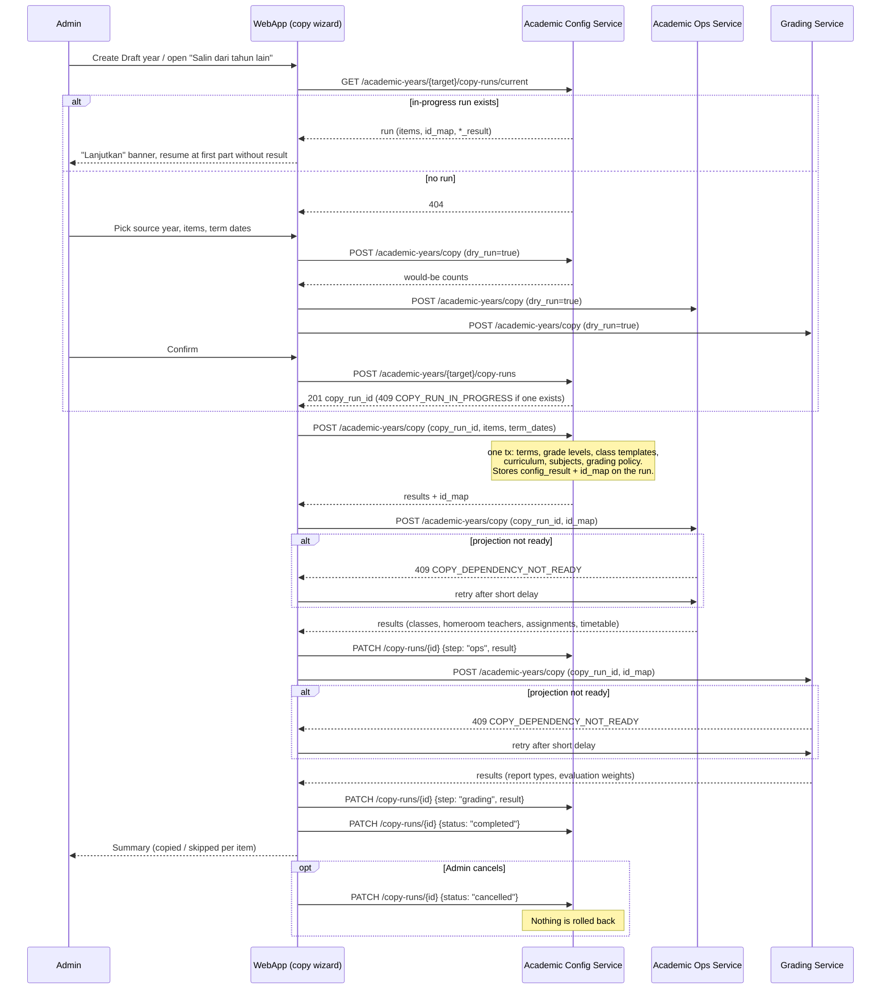

# Sequence Diagram — Academic Year Initialization

The "copy previous year setup" flow is **orchestrated by the web app** (the
copy wizard). Services never call each other: the browser calls one copy
endpoint per service, in order, and carries the source→target `id_map` from
academic-config to academic-ops and grading. Progress is recorded on an
`academic_year_copy_run` row in academic-config so an interrupted copy can be
resumed ("Lanjutkan"). Each service step is one DB transaction and is
idempotent (existing target data is skipped, never overwritten). Design:
`docs/superpowers/specs/2026-11-12-academic-year-copy-design.md`.

Resume: the wizard reads the run, skips parts whose `*_result` is already
stored, and re-sends the stored `id_map` for the remaining parts. Re-running a
finished part is safe — everything reports as skipped.
