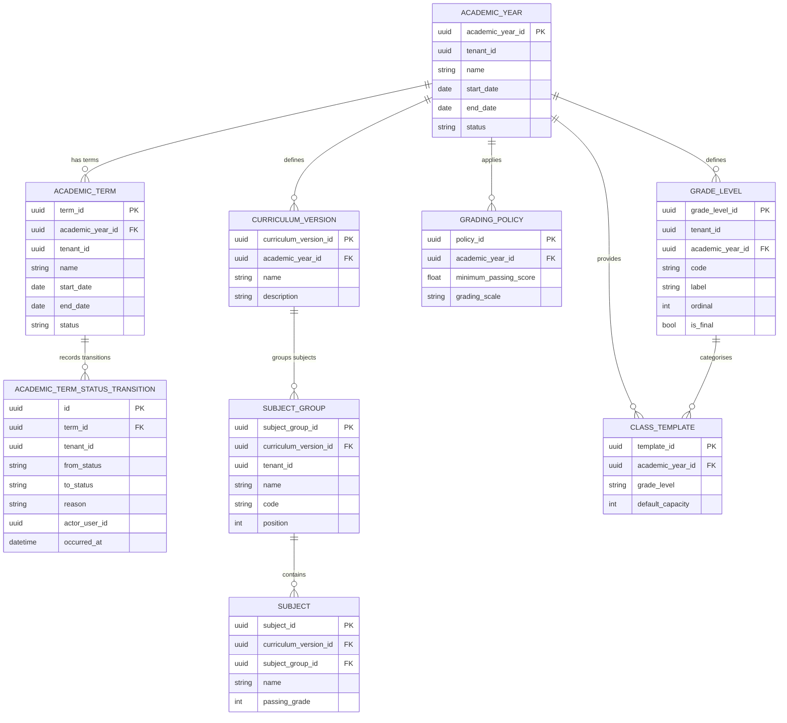

# AkademiQ ERD — Academic Configuration Service

## 🧠 What This Database Owns
This service stores year-based academic structure and rules. It defines how the school operates in a given academic year.

### Main Entities
| Entity | Purpose |
|-------|---------|
| Academic Year | Defines a school year period |
| Academic Term | A child period within a year (e.g. Semester 1, Semester 2) |
| Academic Term Status Transition | Audit log for term lifecycle changes |
| Curriculum Version | Snapshot of curriculum used that year |
| Subject Group | Tenant-defined kelompok above subjects, for report-card presentation |
| Subject | Subjects taught under that curriculum |
| Grading Policy | Rules for scoring and passing |
| Class Template | Default class structure for yearly setup |
| Grade Level | Ordered grade ladder per academic year; `ordinal` drives promotion, `is_final` marks the graduating grade |

## 🔗 Important Relationships
Academic years define curriculum versions and grading policies. Each academic year has at least one term (auto-seeded on creation). Curriculum versions contain subject groups, and each subject belongs to exactly one group. Class templates help initialize homerooms for the year. Grade levels form an ordered ladder per academic year (e.g. Kelas X → XI → XII); a class template optionally categorises into one grade level via the nullable `class_template.grade_level_id` FK, which is replacing the free-text `class_template.grade_level` string during the transition.

## Invariants
- Every `academic_year` always has ≥ 1 `academic_term` (default `"Semester 1"` is seeded on creation).
- At most one term per year may be `Active` (enforced by partial unique index `academic_term_one_active_per_year_idx`).
- Term `start_date`/`end_date` must fall within the parent year's range (app-layer).
- Terms within a year must not overlap (app-layer).
- A year cannot transition to `Closed` while any of its terms is `Active` (`TERM_STILL_ACTIVE`).
- Every `curriculum_version` has ≥ 1 `subject_group` (default `"Umum"` at position 1 is auto-created on curriculum-version creation; the name is the `DEFAULT_SUBJECT_GROUP_NAME` constant).
- Every `subject` belongs to exactly one `subject_group` (`subject.subject_group_id` is `NOT NULL`, FK `ON DELETE RESTRICT`).
- `subject_group` `code`, when present, is unique per `(tenant_id, curriculum_version_id, code)`.
- Deleting a `subject_group` that still has subjects is rejected (`SUBJECT_GROUP_IN_USE`); the `ON DELETE RESTRICT` FK prevents silent cascade.
- `grade_level.code` and `grade_level.ordinal` are each unique per `(tenant_id, academic_year_id)` (`grade_level_code_unique`, `grade_level_ordinal_unique`); violating either returns `GRADE_LEVEL_CODE_TAKEN` / `GRADE_LEVEL_ORDINAL_TAKEN` (409).
- `grade_level.ordinal` must be ≥ 1 (DB `CHECK` `grade_level_ordinal_chk`) and, at the application layer, strictly below 1,000,000 — the reorder endpoint temporarily parks rows at ordinals in that range during its two-phase update, so a real ordinal there could collide with the parking phase. Both bounds are enforced as `VALIDATION_ERROR` (400).
- At most one `grade_level` per academic year may have `is_final = true`; a second is rejected as `VALIDATION_ERROR` (400) on the `is_final` field.
- Deleting a `grade_level` still referenced by a `class_template` is rejected (`GRADE_LEVEL_IN_USE`, 409).
- `grade_level.code` and `grade_level.label` are `VARCHAR(64)`.
