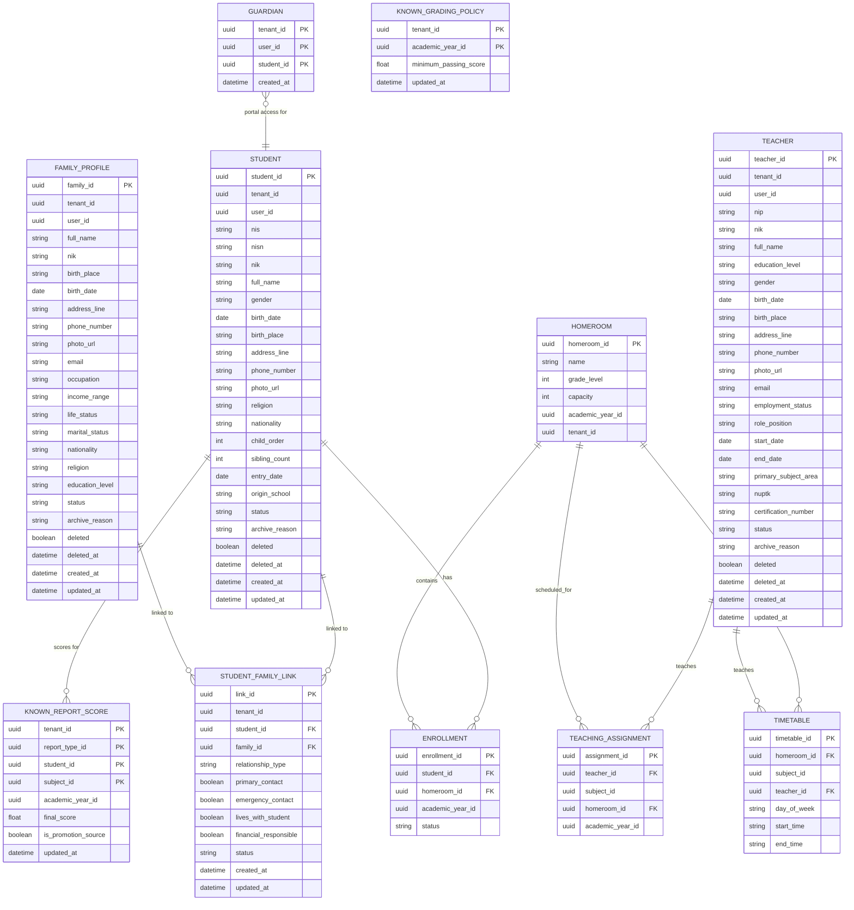

# AkademiQ ERD — Academic Operations Service

## 🧠 What This Database Owns
This service handles daily academic structure, not grades or billing. It owns the
complete operational master data: students, teachers, family profiles, and their photos.

### Main Entities
| Entity | Purpose |
|-------|---------|
| Student | Master student data per tenant (complete Indonesian school biodata) |
| Teacher | Teacher identity inside the school (complete biodata + employment) |
| FamilyProfile | Reusable family/guardian biodata (ayah/ibu/wali), many-to-many with students |
| StudentFamilyLink | Relationship link between a student and a family profile |
| Guardian | Explicit portal/report-card access link (separate from family biodata) |
| Homeroom | A class in a specific academic year |
| Enrollment | Student ↔ Homeroom relationship per year |
| TeachingAssignment | Which teacher teaches which subject in which class |
| Timetable | Weekly schedule for classes |
| KnownReportScore | Projection of published report-card scores, fed by `report_card.published` |
| KnownGradingPolicy | Projection of the minimum passing score per academic year, fed by `grading_policy.configured` |

## 🔗 Important Relationships

### Student ↔ Enrollment ↔ Homeroom
A student can be enrolled in one homeroom per academic year and have multiple historical
enrollments. Student master data does **not** store current class as authoritative state;
class placement is always represented by enrollment records.

### Family profiles ↔ students (many-to-many)
A family profile is reusable biodata that can be linked to multiple students (siblings),
and a student can have multiple family profiles (ayah, ibu, wali). Each link carries
relationship attributes (relationship type, primary/emergency/financial flags,
lives-with-student, active/inactive status).

### Family profiles vs guardian access (critical separation)
- **FamilyProfile + StudentFamilyLink** = administrative biodata for family members.
  Optionally stores a linked IAM `user_id` but does **not** grant portal access.
- **Guardian** = explicit portal/report-card authorization grant for an IAM user to a
  student. Managed independently; creating/removing a family link must never mutate
  guardian access rows.

### Promotion status values (migration V12)
`enrollment.status` and `student.status` were widened to support grade
promotion:
- `enrollment.status` (and the `enrolled_student` projection mirrored in
  grading-service, migration V13) now accepts `'promoted'` alongside
  `'active'`, `'transferred'`, `'unenrolled'`.
- `student.status` now accepts `'lulus'` and `'alumni'` alongside `'aktif'`,
  `'nonaktif'`, `'arsip'`. The two are deliberately distinct: execution sets
  `'lulus'`, and `'alumni'` follows only once the academic year is `Closed`.

Grading's `enrolled_student` constraint ships in lockstep with this
migration because it is a projection of `enrollment`; a lagging `CHECK`
there would silently reject `promoted` events with no visible error.

### Report score & grading policy projections (migration V13)
`known_report_score` and `known_grading_policy` are local read models fed
by RabbitMQ events (`report_card.published` and `grading_policy.configured`
respectively) — CONVENTIONS.md forbids cross-service HTTP calls, so both
facts arrive as events rather than live queries to grading-service /
academic-config-service.

- `known_report_score` primary key is `(tenant_id, report_type_id,
  student_id, subject_id)` — the PK deliberately includes `report_type_id`
  so scores from several report cards for the same student/subject coexist,
  since a school may move the promotion-source flag to a different report
  type after a card is published. Its `is_promotion_source` column is a
  **snapshot taken at publish time**, not the source of truth at evaluation
  time; the promotion engine must re-resolve the current flag from
  academic-config rather than trust this stored value.
- `known_grading_policy` primary key is `(tenant_id, academic_year_id)` and
  stores `minimum_passing_score` as `DOUBLE PRECISION`, matching the
  producer (academic-config-service) and the existing grading-service
  projection — never `NUMERIC`.
- `academic-ops-service` also exposes a `promotion_score_readiness` query
  (not a table) that reports which actively-enrolled students have no row
  in `known_report_score` for a given report type, so a future promotion
  engine can refuse to run rather than silently treating a missing score as
  a zero — which would mean the student repeats the year.

### Photo storage
Student, teacher, and family profile photos are stored as a single active photo per
entity. The `photo_url` column holds a host-agnostic `media://{owner_id}/{media_id}.{ext}`
URI. Uploading a new photo replaces the previous one (single-active, no history). The HTTP
layer resolves this URI to a public serve path
(`/api/v1/academic-ops/media/{owner_type}/{media_id}`) before returning it to the frontend.
Stored blob objects live under the `{owner_type}/` prefix in the configured storage backend
(local or R2). The previous blob is garbage-collected on replace or clear.

### Profile vs IAM contact data
Student, teacher, and family profile email/phone fields are administrative contact data.
Linked IAM user email and membership data remain login/access data and are not
synchronized automatically.
