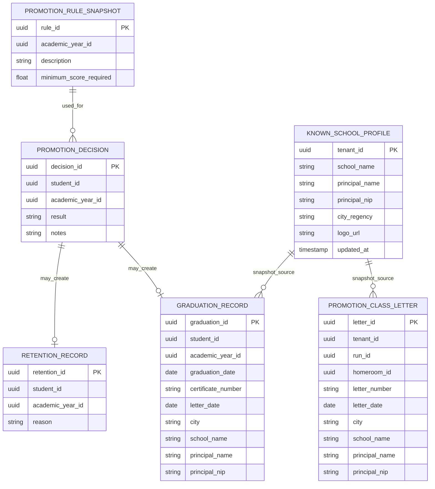

# AkademiQ ERD — Promotion Service

## 🧠 What This Database Owns
This service manages end-of-year academic progression decisions.

### Main Entities
| Entity | Purpose |
|-------|---------|
| Promotion Decision | Student advancement result |
| Graduation Record | Graduation tracking |
| Retention Record | Students repeating a grade |
| Promotion Rule Snapshot | Rules used during promotion evaluation |
| Promotion Class Letter | SK Kenaikan Kelas, one per source homeroom of an executed run |
| Known School Profile | Projection of billing's school profile (`tenant.school_profile_updated`) for letterheads and principal snapshots |

## 🔗 Important Relationships
Promotion decisions are made based on rule snapshots. A decision may produce either a graduation or retention record.

Letters exist only for executed runs. A class letter and a graduate's Surat Keterangan Lulus (the letter columns on `graduation_record`) snapshot `school_name`, `principal_name`, `principal_nip` from `known_school_profile` when first issued; corrections change number, date and city only, and the explicit refresh-principal action re-snapshots every issued letter of the run. Letter numbers are unique per tenant (`promotion_class_letter_number_uidx`, partial `graduation_record_certificate_number_uidx`).